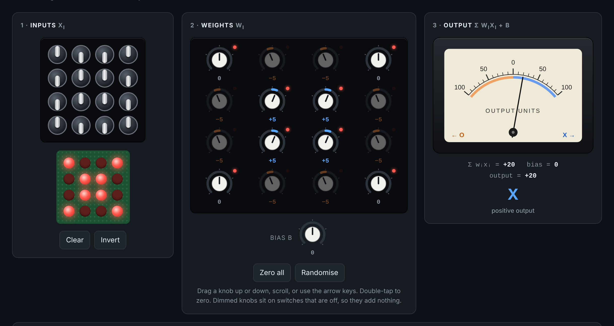
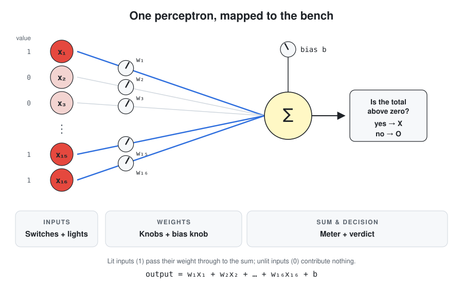
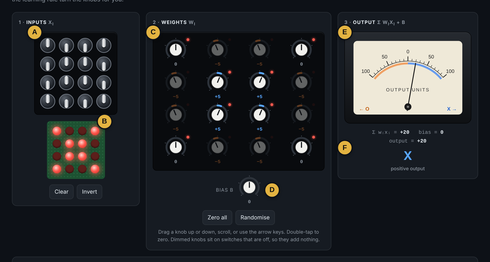
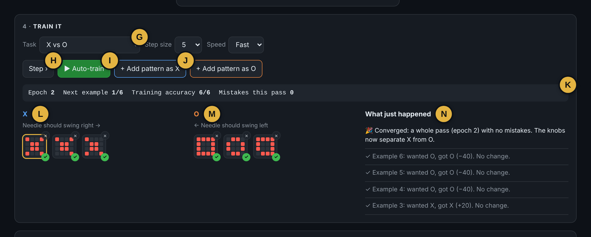
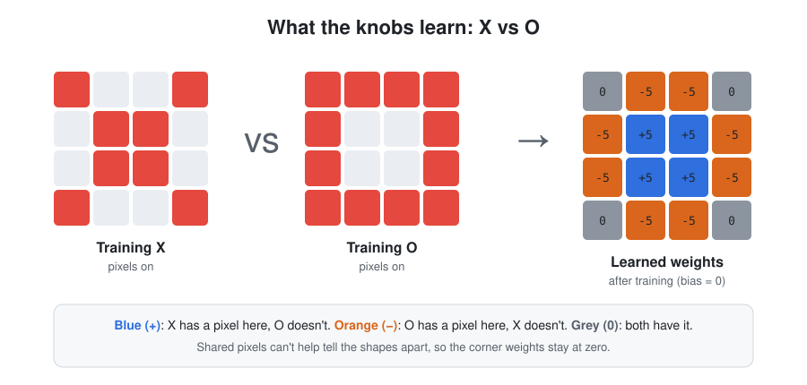
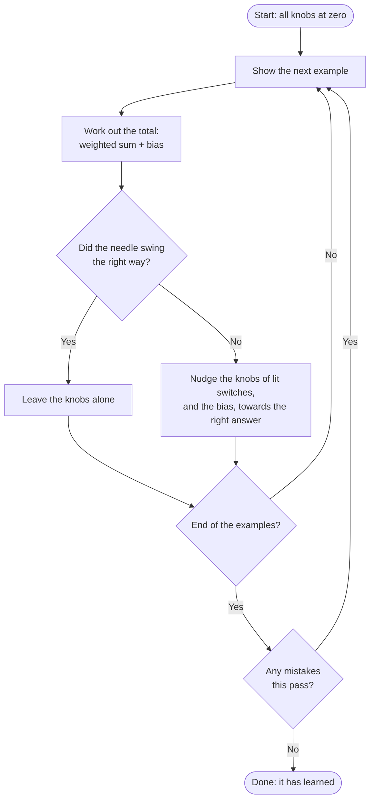
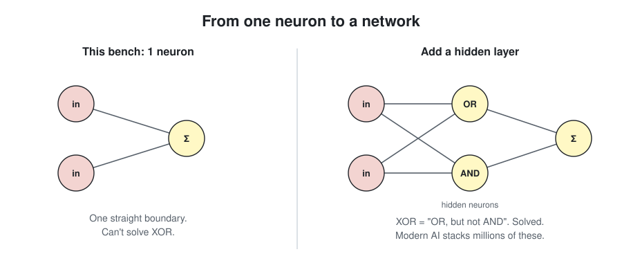

**An interactive, in-browser model of the very first kind of artificial neural network: the perceptron.**

Flip switches to make a pattern, turn knobs to set the weights, and watch a meter needle decide which category the pattern belongs to. Then press a button and watch the machine teach itself.

No installation, no coding, no maths background needed. If you can flick a switch and turn a dial, you can use this.



---

## Contents

- [What is this?](#what-is-this)
- [Why does it matter?](#why-does-it-matter)
- [A little history](#a-little-history)
- [The big idea in plain English](#the-big-idea-in-plain-english)
- [Getting started](#getting-started)
- [A tour of the bench](#a-tour-of-the-bench)
- [Guided activities](#guided-activities)
- [How the learning rule works](#how-the-learning-rule-works)
- [What a perceptron can't do](#what-a-perceptron-cant-do)
- [From one perceptron to modern AI](#from-one-perceptron-to-modern-ai)
- [Using it in teaching](#using-it-in-teaching)
- [Technical details](#technical-details)
- [Glossary](#glossary)

---

## What is this?

Perceptron Bench is a single web page that simulates a **perceptron**: a simple machine that looks at an input and decides which of two groups it belongs to. For example, it might decide whether a pattern looks like an **X** or an **O**.

It's laid out like a piece of lab hardware:

| Part | What it represents |
|---|---|
| 16 toggle switches and a grid of lights | The **input**: a tiny 4×4 black-and-white "image" |
| 16 knobs | The **weights**: how much each pixel matters, and in which direction |
| 1 extra knob | The **bias**: a general lean towards one answer or the other |
| A needle meter | The **output**: the machine's decision |

The design is inspired by hand-built analog perceptrons. These are real circuit boards made of switches, potentiometers (knobs), resistors and a current meter, which people have built to show that a "neuron" can be made from everyday electronic parts.

---

## Why does it matter?

Chatbots, image recognition, voice assistants and recommendation systems all run on **artificial neural networks**. Those networks look mysterious, but they're built from huge numbers of one very simple part.

**This page lets you hold one of those parts in your hands.**

Once you've seen a single perceptron do its job, you understand:

- what a **weight** is, and why AI models are sometimes described as "billions of parameters"
- what it means for a machine to **learn from examples** instead of being programmed with rules
- why **training data** matters so much
- why some problems are **impossible** for simple models, and why that pushed researchers towards bigger, layered networks

---

## A little history

- **1943**: Warren McCulloch and Walter Pitts describe a simplified mathematical model of a brain cell (neuron) that adds up its inputs and "fires" when the total passes a threshold.
- **1957–58**: Psychologist **Frank Rosenblatt** at the Cornell Aeronautical Laboratory invents the **perceptron**. It was a neuron model that could *learn* its own settings from examples. He built it as a physical machine, the **Mark I Perceptron**. Its "eye" was a grid of 400 light sensors, and its weights were knobs (potentiometers) turned by electric motors as it learned.
- **Late 1950s–60s**: The perceptron gets enormous press attention, with bold predictions about machines that would soon see, talk and think.
- **1969**: Marvin Minsky and Seymour Papert publish *Perceptrons*. It proved mathematically that a single perceptron can't solve certain simple problems (see [What a perceptron can't do](#what-a-perceptron-cant-do)). Interest and funding in neural networks drop sharply.
- **1980s onwards**: Researchers show how to train networks with **many layers** of perceptron-like units (using a method called *backpropagation*). This overcomes the old limits and eventually leads to modern deep learning.

Perceptron Bench recreates the Mark I idea at a tiny scale: 16 inputs instead of 400, and knobs you can turn yourself.

---

## The big idea in plain English

Imagine you're judging a talent show with a scorecard. Each act gets points in several categories, but some categories matter more to you than others, so you multiply each score by how important it is. Then you add everything up. If the total is above zero, they're through. If it's below zero, they're out.

A perceptron works the same way:

1. **Look at each input.** Here, each switch is either **on (1)** or **off (0)**.
2. **Multiply each input by its weight.** A big positive weight means "this pixel being on is strong evidence for the first group". A negative weight means "this is evidence for the second group". A weight near zero means "I don't care about this pixel".
3. **Add it all up, plus the bias.**
4. **Decide.** A positive total gives the first group (needle swings right). A negative total gives the second group (needle swings left).

Here's how that maps onto the parts of the bench:



As a formula, the meter shows:

```
output = (w₁ × x₁) + (w₂ × x₂) + … + (w₁₆ × x₁₆) + b
```

where each `x` is a switch (0 or 1), each `w` is a knob, and `b` is the bias.

The clever part isn't the adding up. It's that **the machine can find good knob settings by itself**, just by being shown examples and corrected when it gets them wrong.

---

## Getting started

1. **Open** `perceptron.html` in any modern web browser (Chrome, Edge, Firefox or Safari). It works on laptops, tablets and phones.
2. The page loads the **X vs O** task, with all knobs at zero. The needle sits in the middle because the machine has no opinion yet.
3. Press **▶ Auto-train** and watch:
   - an example pattern appears on the switches
   - the needle swings (or doesn't)
   - if the answer was wrong, some knobs turn
   - this repeats until it gets every example right
4. Now make your own X or O with the switches and see whether it gets it right.

That's it. Everything else is exploring.

---

## A tour of the bench

The bench has four areas. The letters in the screenshots match the notes below.



| Label | Part | What it does |
|:---:|---|---|
| **A** | Input switches | Click to make a pattern (on = 1, off = 0) |
| **B** | Light grid | Shows the pattern you've made |
| **C** | Weight knobs | One per switch, in the same 4×4 layout |
| **D** | Bias knob | Pushes every answer one way or the other |
| **E** | Meter | Swings right or left depending on the total |
| **F** | Readout and verdict | The actual numbers and the final decision |

### 1 · Inputs

- **Click a switch** to flip it on or off. The matching light on the green board lights up, so you can see the pattern you've made.
- **Clear** turns everything off. **Invert** flips every switch.

### 2 · Weights

- **Drag a knob** up or down (or left and right) to turn it. You can also scroll your mouse wheel over it, or click it and use the **arrow keys**.
- **Double-tap or double-click** a knob to reset it to zero.
- Knob colours:
  - **Blue** means a positive weight (pushes towards the first group)
  - **Orange** means a negative weight (pushes towards the second group)
- **Dimmed knobs** sit on switches that are off. Their input is 0, and anything × 0 = 0, so they contribute nothing right now. The little red dot on a knob lights up when its switch is on.
- The **Bias** knob is always active. It shifts the whole answer one way or the other.
- **Zero all** resets every knob. **Randomise** sets them to random values.

### 3 · Output

- The **needle** swings right for the first group and left for the second. The further it swings, the more confident the decision.
- Below the meter you'll see the actual numbers: the weighted sum, the bias, and the final output.
- The large label shows the decision. If the total is exactly zero, it shows **undecided**.

### 4 · Train it



| Label | Part |
|:---:|---|
| **G** | Task menu, step size and speed |
| **H** | Step: one example at a time |
| **I** | Auto-train: keep going until it's learned |
| **J** | Add the current pattern to either group |
| **K** | Status bar: epoch, accuracy and mistakes |
| **L** | Examples for the first group (needle right) |
| **M** | Examples for the second group (needle left) |
| **N** | "What just happened": a plain-English log of each step |

| Control | What it does |
|---|---|
| **Task** | Choose a ready-made set of examples (see below) |
| **Step size** | How far the knobs turn on each correction (the *learning rate*) |
| **Speed** | Slow, to watch closely, or Fast |
| **Step ›** | Show the machine *one* example and correct it if needed |
| **▶ Auto-train** | Keep stepping until it gets a whole round right (or gives up after 30 rounds) |
| **+ Add pattern as …** | Add whatever's on the switches to your training examples |

Your training examples appear as small thumbnails in two columns, one for each group:

- a green **✓** means the current knob settings get that example right
- a red **✗** means they get it wrong
- **click a thumbnail** to load it onto the switches
- **×** removes it

The **status bar** shows the current *epoch* (one full pass through all the examples), training accuracy, and mistakes so far in this pass. The **"What just happened"** panel explains every step in plain words.

### Built-in tasks

| Task | What it learns | Can it succeed? |
|---|---|---|
| **X vs O** | Tell an X shape from an O shape | ✅ Yes, quickly |
| **T vs L** | Tell a T from an L | ✅ Yes |
| **Left vs Right** | Is the pattern on the left or the right side? | ✅ Yes, quickly |
| **XOR** | Is *exactly one* of two corners lit? | ❌ Never. This is deliberate (see below) |
| **Empty** | Your own two groups, A and B | Depends on what you give it! |

---

## Guided activities

These work for self-study or as a class exercise. Each one takes about 5–10 minutes.

### Activity 1: Be the machine

1. Load **X vs O** and leave the knobs at zero.
2. Click the first X thumbnail. The needle reads 0.
3. Without using training, **turn the knobs yourself** until every thumbnail shows a ✓.
4. *Think about it:* which knobs did you make blue, and which orange? Why?

### Activity 2: Watch it learn

1. Reload **X vs O**, set **Speed** to *Slow*, and press **Step ›** repeatedly.
2. Read each message in the "What just happened" panel.
3. *Notice:* the knobs only change when the machine gets something **wrong**, and only knobs whose switches are **on** move.

### Activity 3: Read its mind

1. Train **X vs O** until it converges.
2. Look at the 16 knobs as if they were a 4×4 picture.
3. *Notice:* blue knobs sit where X has pixels and O doesn't. Orange knobs sit where O has pixels and X doesn't. The weights *are* what the machine has learned, and you can see them.



### Activity 4: Test it on something new

1. After training, draw a slightly wonky X with the switches. Does it still say X?
2. Try something that's neither X nor O, like a single line. What does it say, and why?
3. *Think about it:* the machine can only choose between the two groups it was trained on. It has no way to say "I don't know what this is".

### Activity 5: Teach it something new

1. Choose **Empty**.
2. Invent two groups, for example "top-heavy" vs "bottom-heavy", or "few pixels" vs "lots of pixels".
3. Draw 3–4 examples of each and add them with the **+ Add pattern** buttons.
4. Auto-train, then test it with new patterns you haven't shown it.
5. *Think about it:* what happens if you give it confusing or contradictory examples?

### Activity 6: The impossible problem

1. Load **XOR** and press **▶ Auto-train**.
2. Watch it go round in circles, fixing one example and breaking another, until it gives up after 30 epochs.
3. Read the next section to find out why.

---

## How the learning rule works

Rosenblatt's learning rule is short enough to say in one breath:

> **Show it an example. If it gets the answer wrong, nudge every weight whose input was on towards the right answer, and nudge the bias the same way. Repeat.**

More precisely, for each wrong answer:

```
new weight = old weight + (step size × target)     for every switch that is ON
new bias   = old bias   + (step size × target)
```

where **target** is **+1** if the right answer was the first group and **−1** if it was the second.

As a flowchart:



That's the entire learning algorithm. There's no understanding and no rules about what an X "should" look like. It's just small corrections, repeated until the mistakes stop.

The **perceptron convergence theorem** guarantees that if *any* knob settings exist that get every example right, this rule will eventually find one.

> **Note:** in this simulator the knobs stop at ±30, just as a real potentiometer has end stops. That doesn't affect the built-in tasks.

---

## What a perceptron can't do

A single perceptron can only separate the two groups with what amounts to a **straight line**. (With 16 inputs it's really a flat "hyperplane" in 16-dimensional space, but the idea is the same.) Problems where the groups can be split like this are called **linearly separable**.

**XOR** ("exclusive or") isn't linearly separable. The question is "is *exactly one* of these two corners lit?":

| Top-left corner | Bottom-right corner | Answer |
|:---:|:---:|:---:|
| off | off | No |
| on | off | **Yes** |
| off | on | **Yes** |
| on | on | No |

Plot the four cases on a grid and the problem becomes visible:


To say "yes" when only the top-left is on, its weight needs to be positive. The same goes for the bottom-right. But then when *both* are on, the two positives add up to an even bigger "yes", which is the wrong answer. No combination of knob settings gets all four rows right.

This is the limitation Minsky and Papert highlighted in 1969, and it contributed to a long slump in neural-network research.

---

## From one perceptron to modern AI

The fix turned out to be **layers**. Feed the outputs of several perceptrons into *another* perceptron, and the network can carve up the input space with many lines instead of one. That solves XOR, and much more.



Modern networks follow the same basic recipe:

| Perceptron Bench | A modern neural network |
|---|---|
| 16 inputs | Thousands to millions (pixels, words, sounds…) |
| 1 neuron | Millions of neurons in many layers |
| 17 knobs | Millions to *billions* of weights ("parameters") |
| On/off decision | Smooth, graded outputs (probabilities) |
| Rosenblatt's rule | Backpropagation and gradient descent |
| 6 training examples | Millions or billions of examples |

But underneath, each unit is still doing what you've seen here: **multiply inputs by weights, add them up, and pass the result on**.

---

## Using it in teaching

Some suitable contexts:

- **Introductory AI, machine learning or data science**: a concrete first encounter with neurons, weights and training
- **Computing fundamentals**: weighted sums, thresholds and binary inputs
- **History and ethics of technology**: AI hype cycles, from the 1958 headlines to today
- **Maths**: linear functions, vectors and separability
- **Schools outreach and open days**: hands-on and visual, with no setup needed

Suggested discussion questions:

- Is the machine "thinking" about Xs and Os? What is it actually doing?
- Where did its knowledge come from? Whose choices shaped it?
- What would happen if all the training Xs were drawn by one person?
- Why can't it say "I don't know"? Is that a problem for real AI systems?

---

## Technical details

- **Single self-contained file**: HTML, CSS and JavaScript all in `perceptron.html`. There's no build step and no framework.
- **External dependency**: Google Fonts (DM Sans and JetBrains Mono) only. If they can't load, the page falls back to system fonts and still works fully offline.
- **No data collected**: nothing is saved or sent anywhere. Refreshing the page resets everything.
- **Browser support**: current versions of Chrome, Edge, Firefox and Safari, on desktop and mobile.
- **Accessibility**: switches and knobs can be reached with the keyboard. On a focused knob, use the arrow keys (±1), Page Up and Page Down (±5), Home and End (min and max), and `0` (reset). Controls have screen-reader labels.

### Project files

```
perceptron-bench/
├── perceptron.html          ← the whole app
├── README.md                ← this document
├── interface-board.png
├── annotated-board.png
├── annotated-training.png
├── neuron-to-bench.svg
├── learned-weights.svg
├── xor-separability.svg
└── one-to-many.svg
```

> **About the diagrams:** the images are ordinary PNG and SVG files and display anywhere markdown is rendered, as long as they sit next to this README. The learning-rule flowchart is written in **Mermaid**. GitHub draws it automatically; some other markdown viewers (and some static-site themes) need Mermaid switched on, and otherwise show it as a code block.

### Hosting

- **GitHub Pages**: add the file to a repository (renaming it to `index.html` if you want it as the landing page), then enable Pages in the repository settings.
- **Moodle or another VLE**: upload the file as a *File* resource set to open in a new window, or host it elsewhere and link or embed it with an iframe.
- **Locally**: just double-click the file.

### Key settings (in the script)

| Constant | Default | Meaning |
|---|---|---|
| `WMAX` | 30 | Knob limit (± value) |
| `METER_MAX` | 100 | Value at full-scale needle deflection |
| `MAX_EPOCHS` | 30 | When auto-training gives up |
| `PRESETS` | — | The built-in tasks. Add your own by writing patterns as 16-character strings of 0s and 1s, read row by row |

---

## Glossary

| Term | Meaning |
|---|---|
| **Artificial neuron** | A simple unit that adds up weighted inputs and produces an output |
| **Perceptron** | Rosenblatt's artificial neuron, together with its learning rule |
| **Input** | The information the neuron looks at. Here, 16 switches (pixels) |
| **Weight** | A number saying how much an input matters, and in which direction |
| **Bias** | A constant added to the total, so the neuron leans one way by default |
| **Weighted sum** | Each input × its weight, all added together |
| **Classification** | Sorting something into a category |
| **Training data** | The labelled examples the machine learns from |
| **Learning rate / step size** | How big each correction is |
| **Epoch** | One complete pass through all the training examples |
| **Convergence** | The point where training stops making mistakes |
| **Linearly separable** | Two groups that can be split by a single straight line (or flat plane) |
| **XOR** | "Exclusive or": true when exactly one of two things is true |
| **Parameters** | All the adjustable numbers (weights and biases) in a model |
| **Neural network** | Many artificial neurons connected in layers |
| **Backpropagation** | The method used to train multi-layer networks |

---

*Perceptron Bench: one neuron, seventeen knobs, and the idea behind modern AI.*
